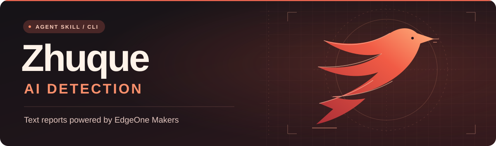
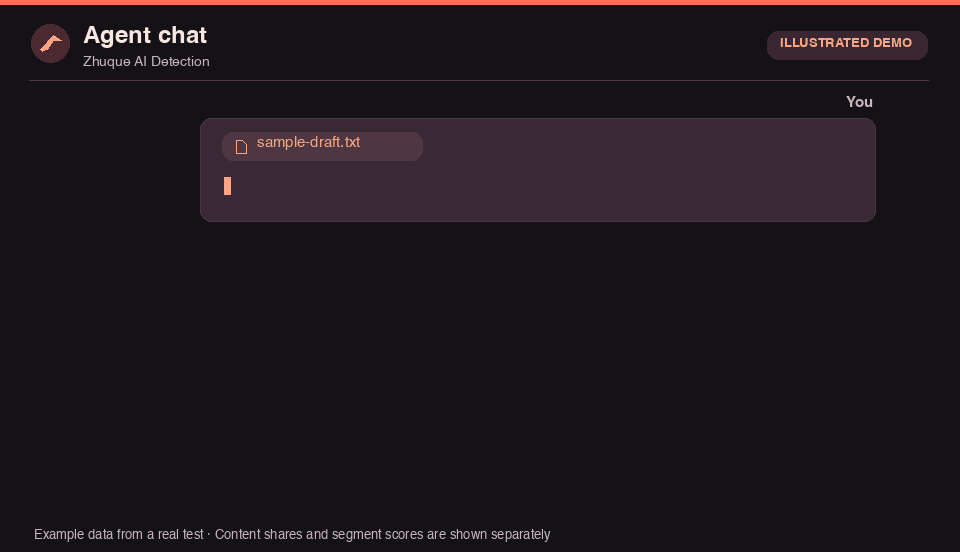

<p align="center">
  
</p>

# Zhuque AI Detection Skill

Give your agent a draft to check for AI-generated content, locate flagged segments, or compare two revisions. **Text checks use Tencent Cloud EdgeOne Makers by default.**

[简体中文](README.md) · **English**　|　[Features](#features) · [Install](#install) · [Configure your key](#key) · [Usage](#usage) · [CLI](#cli)

<a name="features"></a>

## Features

| Feature | Input | Output |
| --- | --- | --- |
| Single draft and segment checks | Pasted text, TXT, Markdown, DOCX | Human, AI, and suspected AI content shares and segment labels |
| Batch checks | A list of draft files | Per-file results, including successful, failed, and unsent items |
| Revision comparison | A first draft and a revision | Percentage-point changes by label and segment results for both drafts |
| Report export | Results from a single check, batch, or comparison | Markdown or JSON, with the source text omitted by default |
| Enterprise Pro | Text, image files, or public image URLs | Text segment results or an image confidence score. Explicit opt-in, billed per call |
| Zhuque website | Text, images, or video | Open the [text checker](https://matrix.tencent.com/ai-detect/ai_gen_txt) or [image and video checker](https://matrix.tencent.com/ai-detect/ai_gen) to check manually |

API checks send the content you select to Tencent. Reports show content shares and segment confidence separately. Use them to guide review.

<a name="install"></a>

## Install the skill

You need **Python 3.10 or later** and a local agent that can load Agent Skills, run Python, and reach Tencent Cloud.

| Agent | Install location or method | Invoke in chat |
| --- | --- | --- |
| **Codex** | `~/.agents/skills/zhuque-ai-detect-skill/` | Type `$` and select the skill. [Official guide](https://learn.chatgpt.com/docs/build-skills) |
| **Claude Code** | `~/.claude/skills/zhuque-ai-detect-skill/` | Type `/zhuque-ai-detect-skill`. [Official guide](https://code.claude.com/docs/en/skills) |
| **Cursor** | `~/.cursor/skills/zhuque-ai-detect-skill/`, or reuse `~/.agents/skills/` | Select the skill from the `/` menu in a local Agent chat. [Official guide](https://cursor.com/docs/skills) |
| **WorkBuddy** | **Skills → Add Skill → Upload Skill**, then import a ZIP | Name `zhuque-ai-detect-skill` in chat. [Official guide](https://www.workbuddy.cn/docs/workbuddy/From-Beginner-to-Expert-Guide/Function-Description/Skills-Market) |

Codex has been tested with a local installation and a live API call. The other entries follow the official installation guides and have yet to be tested end to end.

Clone the project, or select **Code → Download ZIP** on GitHub and extract it. [GitHub repository](https://github.com/byteee-com/zhuque-ai-detect-skill)

```sh
git clone https://github.com/byteee-com/zhuque-ai-detect-skill.git
cd zhuque-ai-detect-skill
```

If you use GitHub over SSH, replace the first line with `git clone git@github.com:byteee-com/zhuque-ai-detect-skill.git`.

- **Codex, Claude Code, and Cursor**: Name the folder containing `SKILL.md`, `scripts/`, and `references/` as `zhuque-ai-detect-skill` and place it in the location listed above. The installed folder should contain `SKILL.md` directly.
- **WorkBuddy**: Zip that folder and import it through **Upload Skill**.

Start a new agent chat after installation.

<details>
<summary>Copy the skill from a terminal</summary>

Run these commands in the extracted project directory that contains `SKILL.md`. They use the Codex location as an example. For Claude Code or Cursor, change the destination to the one in the table above.

**Windows PowerShell**

```powershell
$skillDir = Join-Path $HOME '.agents\skills\zhuque-ai-detect-skill'
New-Item -ItemType Directory -Force -Path $skillDir | Out-Null
Copy-Item -Path .\SKILL.md, .\agents, .\scripts, .\references -Destination $skillDir -Recurse -Force
```

**macOS / Linux**

```sh
skill_dir="$HOME/.agents/skills/zhuque-ai-detect-skill"
mkdir -p "$skill_dir"
cp -R SKILL.md agents scripts references "$skill_dir/"
```

</details>

<a name="key"></a>

## Configure your key

Create a standard key under **Makers → Models → API Key** in the EdgeOne console. See the [Tencent Cloud setup guide](https://cloud.tencent.com/document/product/1552/137539).

Run `setup` from the extracted project directory. Paste the key into your terminal when prompted and press Enter. Input is hidden and the script stores the key in your local user configuration. Run `setup` again to replace it.

| OS | Configure your key | Check local configuration |
| --- | --- | --- |
| Windows PowerShell | `py -3 .\scripts\zhuque.py setup` | `py -3 .\scripts\zhuque.py doctor` |
| macOS / Linux | `python3 scripts/zhuque.py setup` | `python3 scripts/zhuque.py doctor` |

A `makers.status` of `ready` means the configuration is readable. Your first API check verifies that the key works. See the [API configuration reference](references/api.md) for environment variables and Enterprise Pro credentials.

<a name="usage"></a>

## Usage

Attach a draft, paste its text, or give the agent a file path it can read. Select the skill as shown above, or name it in your prompt. The agent runs the script and returns the report in chat.

<p align="center">
  
</p>

<p align="center"><sub>The chat is illustrated. The report figures come from a live API test.</sub></p>

**Check a single draft and show segments**

```text
Use zhuque-ai-detect-skill to check the draft I provided.
Show human, AI, and suspected AI content shares. List each segment's label and confidence by number, and show the actual tokens deducted.
```

**Compare two versions**

```text
Use zhuque-ai-detect-skill to compare first.md and revised.docx.
Use the same segment settings for both. Show percentage-point changes by label and flag segments worth reviewing in each draft.
```

**Check a batch and save the report**

```text
Use zhuque-ai-detect-skill to check A.md, B.docx, and C.txt.
Preflight those three files, then check them individually. Save successful, failed, and unsent items to report.md and omit the source text.
```

**Preflight files locally**

```text
Use zhuque-ai-detect-skill to preflight first.md and revised.docx.
Check the paths, formats, and readability without calling the API.
```

<a name="cli"></a>

## Command line

The Python CLI also runs on its own for local checks, scripts, and report export. Run these commands from the project directory. On Windows, replace `python3 scripts/zhuque.py` with `py -3 .\scripts\zhuque.py`.

```sh
python3 scripts/zhuque.py text --file draft.docx --paragraphs --format markdown
python3 scripts/zhuque.py batch --dry-run first.md revised.docx
python3 scripts/zhuque.py batch --compare --paragraphs first.md revised.docx
```

The CLI outputs JSON by default. See the [API configuration and CLI reference](references/api.md) for more options and error states.
