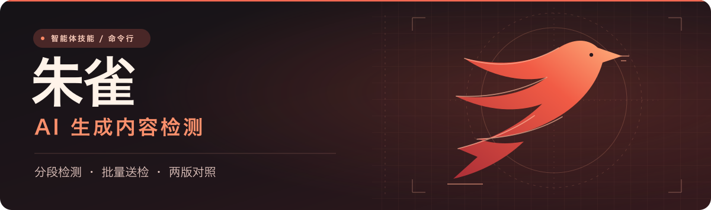
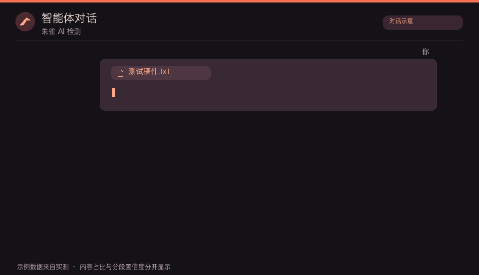

<p align="center">
  
</p>

# 朱雀 AI 检测 Skill

把稿件交给 Agent，就能用腾讯朱雀检测 AI 生成特征、定位可疑分段，或比较两版稿件。**文本默认走 EdgeOne Makers API。**

**简体中文** · [English](README.en.md)　|　[功能列表](#features) · [安装 Skill](#install) · [配置 Key](#key) · [使用方法](#usage) · [命令行](#cli)

<a name="features"></a>

## 功能列表

| 功能 | 输入 | 返回结果 |
| --- | --- | --- |
| 单篇与分段检测 | 粘贴正文、TXT、Markdown、DOCX | 人工、AI、疑似 AI 的内容占比和分段标签 |
| 批量检测 | 指定多份稿件 | 每份稿件的结果，区分成功、失败和未提交 |
| 两版对照 | 初稿和修改稿 | 各类内容占比的百分点变化，以及两版的分段结果 |
| 报告导出 | 单篇、批量或对照结果 | Markdown 或 JSON，默认省略原文 |
| 企业 Pro | 文本、图片文件或公网图片 URL | 文本分段结果或图片的 AI 置信度。需显式选择，按次计费 |
| 朱雀官网 | 文本、图片或视频 | 用户手动打开[文本检测](https://matrix.tencent.com/ai-detect/ai_gen_txt)或[图片与视频检测](https://matrix.tencent.com/ai-detect/ai_gen) |

API 检测会把你指定的内容发送给腾讯。内容占比与分段置信度分开报告，结果供复核参考。

<a name="install"></a>

## 安装 Skill

需要 **Python 3.10+**，以及能在本机加载 Agent Skills、运行 Python 和访问腾讯云的客户端。

| Agent | 安装位置或方式 | 在对话中调用 |
| --- | --- | --- |
| **Codex** | `~/.agents/skills/zhuque-ai-detect-skill/` | 输入 `$` 选择 Skill。 [官方文档](https://learn.chatgpt.com/docs/build-skills) |
| **Claude Code** | `~/.claude/skills/zhuque-ai-detect-skill/` | 输入 `/zhuque-ai-detect-skill`。 [官方文档](https://code.claude.com/docs/en/skills) |
| **Cursor** | `~/.cursor/skills/zhuque-ai-detect-skill/`，也可复用 `~/.agents/skills/` | 在本地 Agent 对话中用 `/` 选择 Skill。 [官方文档](https://cursor.com/docs/skills) |
| **WorkBuddy** | 「技能 → 添加技能 → 上传技能」，导入 ZIP 包 | 在对话中点名 `zhuque-ai-detect-skill`。 [官方文档](https://www.workbuddy.cn/docs/workbuddy/From-Beginner-to-Expert-Guide/Function-Description/Skills-Market) |

Codex 已完成本地安装和 API 实测。其他客户端的安装入口按官方文档列出，尚未逐个做端到端验证。

先克隆项目，或在 GitHub 仓库页面点 **Code → Download ZIP**，下载后解压。 [GitHub 仓库](https://github.com/byteee-com/zhuque-ai-detect-skill)

```sh
git clone https://github.com/byteee-com/zhuque-ai-detect-skill.git
cd zhuque-ai-detect-skill
```

已配置 GitHub SSH 的用户，可以把第一行换成 `git clone git@github.com:byteee-com/zhuque-ai-detect-skill.git`。

- **Codex、Claude Code、Cursor**：将包含 `SKILL.md`、`scripts/` 和 `references/` 的目录命名为 `zhuque-ai-detect-skill`，放到上表对应位置。安装目录里应直接看到 `SKILL.md`。
- **WorkBuddy**：把这个同名目录压成 ZIP，再从「上传技能」导入。

安装后开一个新的 Agent 对话。

<details>
<summary>使用终端复制到 Skill 目录</summary>

在解压后能看到 `SKILL.md` 的项目目录运行。命令以 Codex 的路径为例，Claude Code 和 Cursor 按上表替换目标目录。

**Windows PowerShell**

```powershell
$skillDir = Join-Path $HOME '.agents\skills\zhuque-ai-detect-skill'
New-Item -ItemType Directory -Force -Path $skillDir | Out-Null
Copy-Item -Path .\SKILL.md, .\agents, .\scripts, .\references -Destination $skillDir -Recurse -Force
```

**macOS / Linux**

```sh
skill_dir="$HOME/.agents/skills/zhuque-ai-detect-skill"
mkdir -p "$skill_dir"
cp -R SKILL.md agents scripts references "$skill_dir/"
```

</details>

<a name="key"></a>

## 配置 Key

在 EdgeOne 控制台的 **Makers → Models → API Key** 创建普通 Makers Key。参见 [腾讯云朱雀接入文档](https://cloud.tencent.com/document/product/1552/137539)。

在解压后的项目目录运行 `setup`，按提示把 Key 粘贴到终端并回车。输入不会回显，脚本会保存到当前用户的本机配置。换 Key 时重新运行 `setup`。

| 系统 | 配置 Key | 检查配置 |
| --- | --- | --- |
| Windows PowerShell | `py -3 .\scripts\zhuque.py setup` | `py -3 .\scripts\zhuque.py doctor` |
| macOS / Linux | `python3 scripts/zhuque.py setup` | `python3 scripts/zhuque.py doctor` |

`doctor` 显示 `makers.status: ready` 表示配置可读取。第一次 API 检测会验证 Key 是否有效。环境变量和企业 Pro 的配置见 [API 配置说明](references/api.md)。

<a name="usage"></a>

## 使用方法

在 Agent 对话中附上稿件、粘贴正文，或提供 Agent 能读取的文件路径。按上表选中 Skill，也可以在提示词里点名。Agent 会调用脚本并在对话里返回报告。

<p align="center">
  
</p>

<p align="center"><sub>对话界面为示意，报告中的数字来自实际 API 测试。</sub></p>

**检测单篇，查看分段**

```text
用 zhuque-ai-detect-skill 检测我提供的稿件。
列出人工、AI、疑似 AI 的内容占比，按分段编号给出标签和置信度，并报告实际扣减 token。
```

**比较两版稿件**

```text
用 zhuque-ai-detect-skill 对照初稿.md 和修改稿.docx。
用同样的分段设置检测两版，列出各类内容占比的百分点变化，并标出各自值得复核的分段。
```

**批量检测并保存报告**

```text
用 zhuque-ai-detect-skill 批量检测 A.md、B.docx 和 C.txt。
先预检这三个文件，再逐份检测。将成功、失败和未提交项写入 report.md，省略原文。
```

**仅做本地预检**

```text
用 zhuque-ai-detect-skill 预检初稿.md 和修改稿.docx。
只检查路径、格式和可读性，不调用 API。
```

<a name="cli"></a>

## 命令行

Python 命令也可以独立使用，适合本地检查、脚本集成和报告导出。以下命令在项目目录运行。Windows 用户将 `python3 scripts/zhuque.py` 换成 `py -3 .\scripts\zhuque.py`。

```sh
python3 scripts/zhuque.py text --file draft.docx --paragraphs --format markdown
python3 scripts/zhuque.py batch --dry-run first.md revised.docx
python3 scripts/zhuque.py batch --compare --paragraphs first.md revised.docx
```

命令行默认输出 JSON。更多参数和错误状态见 [API 配置与命令参考](references/api.md)。
